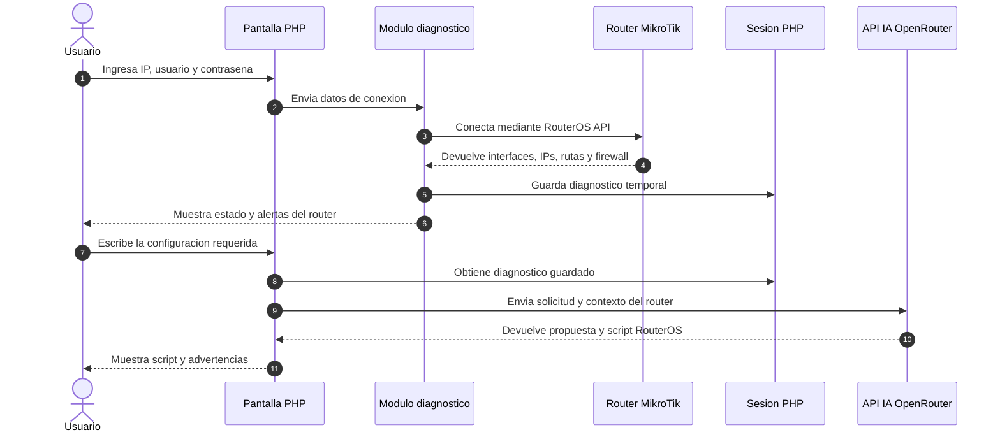

# Documento de Transferencia Técnica y Arquitectura (Handover)

## 1. Propósito del Proyecto y Objetivos
* **Problema que resuelve:** Este modulo es el complemento de un sistema que genera scripts de configuración para routers Mikrotik
* **Objetivo Original:** Implementar una API de IA para generar las configuraciones
* **Alcance logrado:** Hasta ahora se a logrado obtener diagnostico del router por medio de analisis y con ayuda de IA

## 2. Stack Tecnológico

| Componente | Tecnología / Herramienta | Versión | Motivo de uso / Función |
| :--- | :--- | :--- | :--- |
| **Lenguaje** | `PHP` | `v8.3.30` | Lenguaje base de la aplicación. |
| **Framework** | `Ninguno aún` | `sin versión` | Creación de APIs y enrutamiento rápido. |
| **Base de Datos** | `Mysql`| `v8.4.3 ` | Almacenamiento relacional |
| **Librerías Clave**| `Ninguna en especifico` | `sin versión` | Validaciones de datos y peticiones HTTP. |
| **Servicios Cloud**| `Sin servicios cloud aun` | `--` | Almacenamiento de archivos y contenedores. |

## 3. Estructura del Proyecto (Carpetas y Archivos)
A continuación se detalla la distribución del árbol de directorios del código fuente:

```text
mikrotik-modulos/
├── README.md # Documento de transferencia técnica y arquitectura
├── documentacion # Documentos y reportes
│   ├── reporte-avance-2026-07-06.md
│   ├── reporte-avance-2026-07-08.md
│   └── reporte-avance-2026-07-09.md
└── modulos  # Modulos que se implementan al sistema
    ├── diagnostico # Modulo de diagnostico
    │   ├── api # API de conexión a routerOS
    │   │   └── routeros_api.class.php
    │   ├── conectar.php # Conexión hacia el router
    │   ├── index.php # Panel de visualización de información
    │   ├── leer_router.php # Acciones para leer datos del router 
    │   └── preparar_contexto.php # Preparación de información para contexto hacia la IA
    └── ia # Modulo de Procesamiento de información por mdeio de IA
        ├── index.php # Panel De visualización
        ├── openai.php # Conexión con API de IA
        ├── procesar.php # Procesamiento de información del contexto
        ├── proponer.php # Envio de propuesta por la IA
        └── test.php # Este archivo solo es una prue
```

## 4. Flujo General del Proyecto e Integración
Cuando un usuario o sistema externo realiza una acción, el proyecto procesa la información a través del siguiente flujo de secuencia:



<!-- ## 5. Diseño y Arquitectura de la Base de Datos
El sistema utiliza un motor estructurado bajo el siguiente Modelo Entidad-Relación (ERD):

```mermaid
erDiagram
    USUARIO ||--o{ ORDEN : "realiza"
    USUARIO {
        int id PK
        string nombre
        string correo UNIQUE
    }
    ORDEN {
        int id PK
        int usuario_id FK
        float total
        date fecha
    }
``` -->

## 5. Configuración, Despliegue y Comandos Clave

### Variables de Env (`.env`)
El proyecto requiere un archivo `.env` en la raíz de la carpeta ia con las siguientes variables:
* `OPENROUTER_API_KEY`: Clave de autenticación para acceder a la API de OpenRouter.
* `OPENROUTER_API_URL`: URL del endpoint de OpenRouter utilizado para enviar solicitudes de chat.
* `OPENROUTER_MODEL`:Modelo de IA que utilizará OpenRouter para procesar las solicitudes.
* `OPENROUTER_HTTP_REFERER`: URL de referencia enviada a OpenRouter para identificar el origen de las solicitudes.
* `OPENROUTER_X_TITLE`: Nombre de la aplicación que se envía a OpenRouter como identificación.

<!-- ### Comandos de Consola Clave
* **Instalación de dependencias:** `npm install` o `pip install -r requirements.txt`
* **Ejecutar en entorno de desarrollo:** `npm run dev` o `uvicorn main:app --reload`
* **Ejecutar pruebas locales:** `npm test` o `pytest`
* **Compilar con Docker:** `docker build -t proyecto-dual .` -->

## 6. Estado Actual del Proyecto y Deuda Técnica

### Terminado (Done)

- [x] Módulo de diagnóstico para conectar con routers MikroTik mediante RouterOS API.
- [x] Lectura de información del router: interfaces, direcciones IP, rutas, firewall, NAT, DHCP, Hotspot, colas, servicios y otros datos.
- [x] Visualización del diagnóstico y alertas sobre datos faltantes o riesgos detectados.
- [x] Preparación del diagnóstico como contexto para la IA.
- [x] Integración con OpenRouter para generar propuestas de configuración MikroTik.
- [x] Generación de scripts sugeridos, advertencias y pasos de validación.
- [x] Uso de sesión PHP para restringir el acceso a los módulos cuando no existe el código de sesión.

### A medias (In Progress)

- [ ] Integración del generador de IA sin contexto con el flujo principal del diagnóstico.
- [ ] Revisión y mejora de validaciones de datos enviados desde formularios.
- [ ] Mejora de la interfaz para facilitar la lectura de diagnósticos extensos y scripts generados.

### Pendiente / Problemas conocidos (Backlog & Bugs)

- [ ] No existe base de datos ni persistencia permanente de diagnósticos, propuestas o historial de usuarios.
- [ ] El diagnóstico se guarda únicamente en la sesión PHP; se pierde al cerrar o expirar la sesión.
- [ ] El sistema no aplica automáticamente el script generado al router; el usuario debe copiarlo y ejecutarlo manualmente.
- [ ] Las credenciales del router se reciben por formulario y deben reforzarse con validación adicional y medidas de seguridad.
- [ ] La clave de OpenRouter depende del archivo `modulos/ia/.env`, el cual debe configurarse manualmente.
- [ ] Si la IA devuelve JSON inválido o una respuesta inesperada, la propuesta no puede procesarse correctamente.
- [ ] Faltan pruebas automatizadas para la conexión MikroTik, la preparación del contexto y las respuestas de IA.
